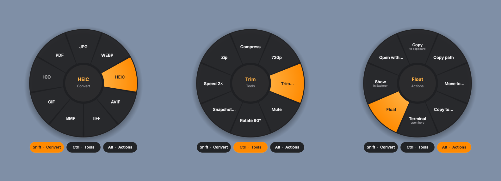
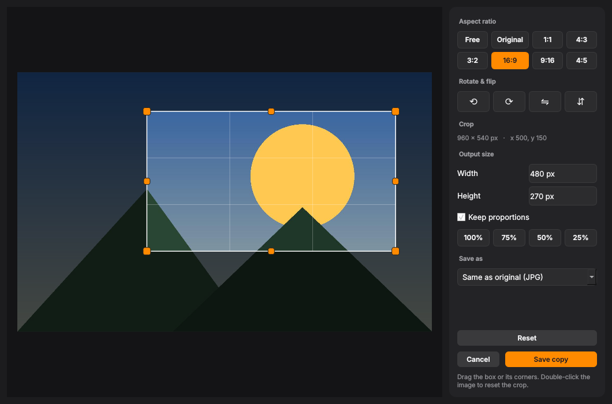
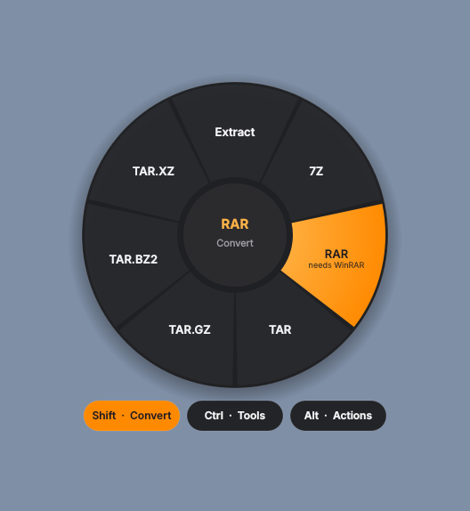
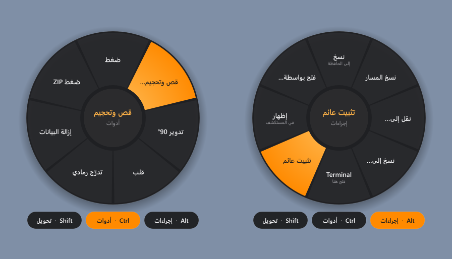

<p align="center">
  
</p>

<h1 align="center">DragWheel</h1>

<p align="center">
  <b>Drag a file. Tap a key. Drop it on the wheel.</b><br>
  An offline, zero-click file converter and toolbox for Windows. Nothing is ever uploaded.
</p>

<p align="center">
  <a href="../../releases/latest"><b>⬇ Download the installer</b></a> ·
  <a href="#how-to-use">How to use</a> ·
  <a href="#supported-formats">Formats</a> ·
  <a href="#build-from-source">Build</a>
</p>



---

## Why

Converting a file usually means opening an app or uploading it to a website you don't control. DragWheel puts a radial menu right under your cursor **while you are already dragging the file**, so converting a HEIC photo to JPG, compressing a video, or turning a folder into a 7z takes one gesture, and everything happens on your own PC.

Inspired by [Tangerine for Mac](https://tangerineformac.com/).

## How to use

Start dragging any file or folder in File Explorer or on the desktop. While the mouse button is still held:

| Do this | You get |
|---|---|
| Tap **Shift** | **Convert** wheel: every format the file can become |
| Tap **Ctrl** | **Tools** wheel: compress, crop & resize, trim, merge, split… |
| Tap **Alt** | **Actions** wheel: copy, copy path, move to, terminal here, float… |
| **Scroll the mouse wheel** | Opens the Convert wheel. Keep scrolling to move between slices |

Then **release over a slice** to apply it. Release in the middle (or press **Esc**) to cancel. Tap another key, or hover one of the pills under the wheel, to switch wheels without letting go.

Results are saved next to the original (`photo.webp`, `clip compressed.mp4`, …). The original file is never changed.

**Without dragging:** select files and press **Ctrl + Alt + Space**, or right-click → **DragWheel** (on Windows 11: *Show more options*), or **Send to → DragWheel**. Then pick with the mouse, the scroll wheel, or the arrow keys + Enter. Tab switches wheels, Esc closes.

All keys can be changed in **Settings** (tray icon → Settings).

## Features

- **Hundreds of conversions** across images, video, audio, PDF, documents, slides, spreadsheets, subtitles, e-books and archives
- **File tools:** compress, crop & resize editor, rotate, flip, grayscale, strip metadata, trim, mute, 720p, snapshot, speed, normalize, fade, merge, split PDF pages, extract pages or images, password-protect PDFs
- **Crop & Resize editor** with live preview, aspect presets (Free, Original, 1:1, 4:3, 3:2, 16:9, 9:16, 4:5), rotate/flip and an exact output size
- **Archive converter:** turn any ZIP, 7Z, RAR, TAR, TAR.GZ, TAR.BZ2 or TAR.XZ into any other, or compress folders straight into one
- **Float:** pin any file on top of all windows, drag it anywhere, scroll to resize it, and drag it into another app later
- **14 languages:** English, العربية, فارسی and اردو (full right-to-left layout), Français, Español, Português, Italiano, Deutsch, Türkçe, Русский, हिन्दी, 简体中文, 日本語
- **Dark and light themes:** follow Windows or pick one in Settings
- **Cancel any time:** every conversion shows a notification with a **Cancel** button; partial files are cleaned up
- **Updates built in:** checks this GitHub page once a day (can be turned off) and offers *Download & install*
- **100% offline conversions.** No accounts, no uploads, no telemetry. The only connection is the optional update check

<table>
  <tr>
    <td></td>
    <td></td>
  </tr>
  <tr>
    <td align="center">Crop &amp; Resize editor</td>
    <td align="center">Archive conversions</td>
  </tr>
  <tr>
    <td></td>
    <td></td>
  </tr>
  <tr>
    <td align="center">Arabic interface</td>
    <td align="center">Float</td>
  </tr>
</table>

## Supported formats

| Category | Opens | Converts to | Tools |
|---|---|---|---|
| **Images** | JPG, PNG, WebP, HEIC, AVIF, TIFF, BMP, GIF, ICO, SVG, PSD, TGA, DDS, JPEG 2000, PCX, PPM, QOI, ICNS | PNG, JPG, WebP, HEIC, AVIF, TIFF, BMP, GIF, ICO, TGA, JPEG 2000, ICNS, PDF | Compress, Crop & Resize, rotate, flip, grayscale, strip metadata, combine into PDF |
| **Video** | MP4, MOV, MKV, WebM, AVI, WMV, M4V, FLV, MPG, 3GP, TS, MTS/M2TS, VOB, OGV, MXF, F4V, ASF | MP4, MP4 H.265 (smaller), MOV, MKV, WebM, AVI, WMV, GIF, MP3/M4A (audio only) | Compress, 720p, trim, mute, rotate, snapshot, 2× speed, merge |
| **Audio** | MP3, M4A, WAV, FLAC, OGG, Opus, AIFF, WMA, AAC, AC3, MKA, CAF, M4B, AMR, AU, DTS | MP3, M4A, WAV, FLAC, OGG, Opus, AIFF, WMA, AC3 | Compress, trim, normalize loudness, mono, fade in/out, merge |
| **PDF** | PDF | DOCX, PNG, JPG, TXT, Markdown, HTML | Compress, split pages, extract pages, rotate, extract images, password, merge |
| **Documents** | DOCX, DOC, RTF, ODT, Markdown, TXT, HTML | PDF, DOCX, ODT, RTF, TXT, HTML, Markdown | |
| **Slides** | PPTX, PPT, ODP | PDF, PNG, JPG, PPTX, ODP | |
| **Spreadsheets** | XLSX, XLS, ODS, CSV, TSV | XLSX, CSV, TSV, JSON, HTML, Markdown table, PDF, ODS | |
| **Subtitles** | SRT, VTT, ASS/SSA | SRT, VTT, ASS, TXT | |
| **E-books & comics** | EPUB, MOBI, FB2, CBZ, XPS/OXPS | PDF, TXT, Markdown, HTML (+ PNG/JPG pages for CBZ/XPS) | |
| **Archives** | ZIP, 7Z, RAR, TAR, TAR.GZ, TAR.BZ2, TAR.XZ, GZ, BZ2, XZ, ISO, CAB | Extract, ZIP, 7Z, RAR, TAR, TAR.GZ, TAR.BZ2, TAR.XZ | |
| **Folders / any files** | | ZIP, 7Z, RAR, TAR, TAR.GZ, TAR.BZ2, TAR.XZ | |

**Built in:** ffmpeg (video/audio), MuPDF (PDF/EPUB), Pillow (images), ZIP/7Z/TAR.

**Uses what you already have:**
- Word, PowerPoint and Excel conversions use **Microsoft Office** if it's installed (it runs invisibly in the background), otherwise **LibreOffice**.
- **Opening RAR** works with 7-Zip, WinRAR, or the `tar` tool built into Windows. **Creating RAR** needs WinRAR (RAR is a closed format); the slice is marked *needs WinRAR* if it's missing.

## Install

1. Download **`DragWheel-Setup-1.1.3.exe`** from [Releases](../../releases/latest).
2. Run it. It asks for administrator rights and installs for all users into `C:\Program Files\DragWheel`.
3. Choose your options: Explorer right-click menu + Send To, start with Windows, desktop shortcut. The installer is available in English and Arabic.

DragWheel then sits in the system tray. To remove it, use **Settings → Apps** or *Uninstall DragWheel* in the Start menu.

> Releases are being prepared for code signing through the SignPath Foundation (see [Code signing policy](#code-signing-policy)). Until then, Windows SmartScreen may warn you about the installer. Choose **More info → Run anyway**.

**Requirements:** Windows 10 (1809+) or Windows 11, 64-bit.

## Build from source

You need Python 3.12 (64-bit).

```bat
git clone https://github.com/ilukezippo/DragWheel.git
cd DragWheel
run.bat      :: first run creates a .venv, installs dependencies, starts DragWheel in the tray
build.bat    :: builds dist\DragWheel\DragWheel.exe, plus the installer if NSIS is installed
```

To get NSIS for the installer: `winget install NSIS.NSIS`.

Every push to `main` builds the installer and a portable zip with GitHub Actions and publishes them as release `v<VERSION>` (the `VERSION` in `dragwheel.pyw`). Bump the version to publish a new release; the app's update check picks it up.

### Project layout

```
dragwheel.pyw   app: wheel, tray, toast, float window, settings, drag watcher
editor.py       crop & resize editor
engine.py       every conversion and tool (no UI, usable from your own scripts)
i18n.py         translations; add a language by adding one dictionary
updater.py      update check against GitHub releases
winsys.py       Windows plumbing: input state, mouse-wheel hook, Explorer selection, registry
installer/      NSIS installer script and artwork
```

`engine.py` works without the app:

```python
import engine
ops = {op.id: op for op in engine.conversions(["photo.heic"])}
engine.run_op(ops["to_jpg"], ["photo.heic"])        # -> photo.jpg
```

## How it works

- A small watcher polls the mouse and keyboard state. It installs no keyboard hooks and doesn't inject into other apps. A low-level mouse hook is used only to see the scroll wheel while you're dragging.
- When a file drag is in progress (Explorer shows its drag image) and you tap a wheel key or scroll, the wheel appears under the cursor. DragWheel asks Explorer which files are being dragged, and the wheel window is also a normal drop target.
- The drop always counts as a **copy**, so Explorer never moves or deletes your original.
- Conversions run in the background, and a notification shows the result with a **Show** button.
- Update check: one request to `api.github.com/repos/ilukezippo/DragWheel/releases/latest` per day, only if enabled.
- A log is kept at `%LOCALAPPDATA%\DragWheel\dragwheel.log` to help with troubleshooting.

## Known limits

- Windows doesn't allow dragging from an app running as administrator into DragWheel (or the other way round).
- Some apps start drags without a drag image. For those, set *Trigger on → Any mouse drag* in Settings.

## Code signing policy

Free code signing provided by [SignPath.io](https://about.signpath.io), certificate by [SignPath Foundation](https://signpath.org).

**Team roles**

| Role | Members |
|---|---|
| Committers and reviewers | [ilukezippo](https://github.com/ilukezippo) |
| Approvers | [ilukezippo](https://github.com/ilukezippo) |

Every release is built from this repository's source by GitHub Actions and manually approved before signing.

**Privacy:** DragWheel does not transfer any information to other networked systems, except the optional update check that asks GitHub for the latest release (can be turned off in Settings). See the [privacy policy](PRIVACY.md).

## License

[MIT](LICENSE) © ilukezippo
